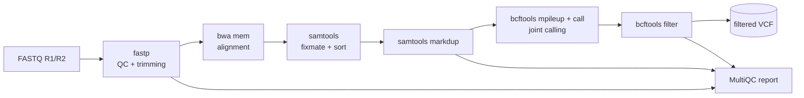

# NGS variant-calling pipeline


A reproducible [Snakemake](https://snakemake.readthedocs.io) workflow for **germline
short-variant (SNP/indel) calling** from paired-end Illumina whole-genome or targeted
sequencing data.



| Step | Tool | Output |
|------|------|--------|
| Read QC & adapter/quality trimming | fastp | `results/trimmed/`, `results/qc/fastp/` |
| Alignment (with read groups) | bwa mem | |
| Mate fixing, coordinate sort | samtools fixmate / sort | |
| Duplicate marking | samtools markdup | `results/aligned/*.markdup.bam(.bai)` |
| Alignment metrics | samtools flagstat / stats | `results/qc/samtools/` |
| Joint variant calling (all samples) | bcftools mpileup + call `-mv` | `results/variants/all.raw.vcf.gz` |
| Soft filtering (`FILTER=LowQual`) | bcftools filter | `results/variants/all.filtered.vcf.gz(.tbi)` |
| Variant metrics (Ti/Tv, per-sample counts) | bcftools stats | `results/qc/bcftools/` |
| Aggregated report | MultiQC | `results/qc/multiqc_report.html` |

## Quick start

```bash
git clone https://github.com/NIBIL401/ngs-variant-calling-pipeline.git
cd ngs-variant-calling-pipeline

# Option A: one environment with every tool
mamba env create -f environment.yaml
mamba activate ngs-variant-calling

# Run the built-in test: simulate a small genome + reads with 30 planted SNPs
python .test/simulate.py .test/data
snakemake --cores 4 --configfile .test/config.yaml
python .test/check_truth.py .test/data/truth.tsv .test/results/variants/all.filtered.vcf.gz
```

```
truth SNPs:            30
PASS SNP calls:        30
recall:                1.000
precision:             1.000
genotype concordance:  ...
OK
```

### Option B: per-rule conda environments

Only Snakemake is needed; every rule gets a pinned environment from `workflow/envs/`:

```bash
snakemake --cores 8 --software-deployment-method conda
```

## Running on your own data

1. List your samples in `config/samples.tsv` (tab-separated):

   ```
   sample   fq1                          fq2
   NA12878  data/NA12878_R1.fastq.gz     data/NA12878_R2.fastq.gz
   ```

2. Point `reference` in `config/config.yaml` at your FASTA (e.g. `resources/GRCh38.fa`).
   The bwa index and `.fai` are built automatically if missing.
3. Tune trimming (`fastp.extra`), pileup options (`bcftools.mpileup_extra`) and the
   soft-filter expression (`bcftools.filter_expression`).
4. Preview the jobs, then run:

   ```bash
   snakemake -n --cores 8
   snakemake --cores 8
   snakemake --dag | dot -Tsvg > dag.svg   # optional: visualise the workflow
   ```

## Continuous integration

Every push runs the whole pipeline in GitHub Actions on freshly simulated data
(two samples, 20 kb genome, ~30x coverage, with heterozygous and homozygous SNPs). The build
fails if SNP recall or precision against the planted truth set drops below 90%.
The MultiQC report and VCFs are uploaded as build artifacts.

## Repository layout

```
├── config/
│   ├── config.yaml        # parameters
│   └── samples.tsv        # sample sheet
├── workflow/
│   ├── Snakefile          # rules
│   └── envs/              # per-rule conda environments
├── .test/
│   ├── simulate.py        # synthetic genome + reads + truth set
│   ├── check_truth.py     # recall / precision / genotype concordance
│   └── config.yaml        # test configuration
└── environment.yaml       # single all-in-one environment
```

## License

MIT
